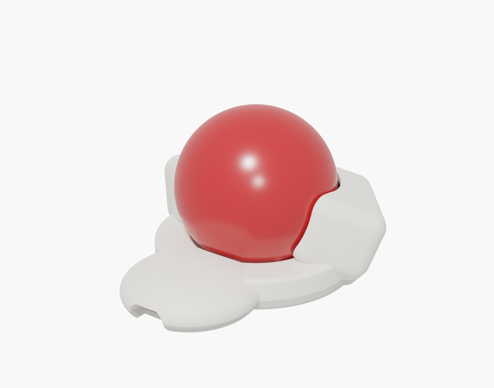
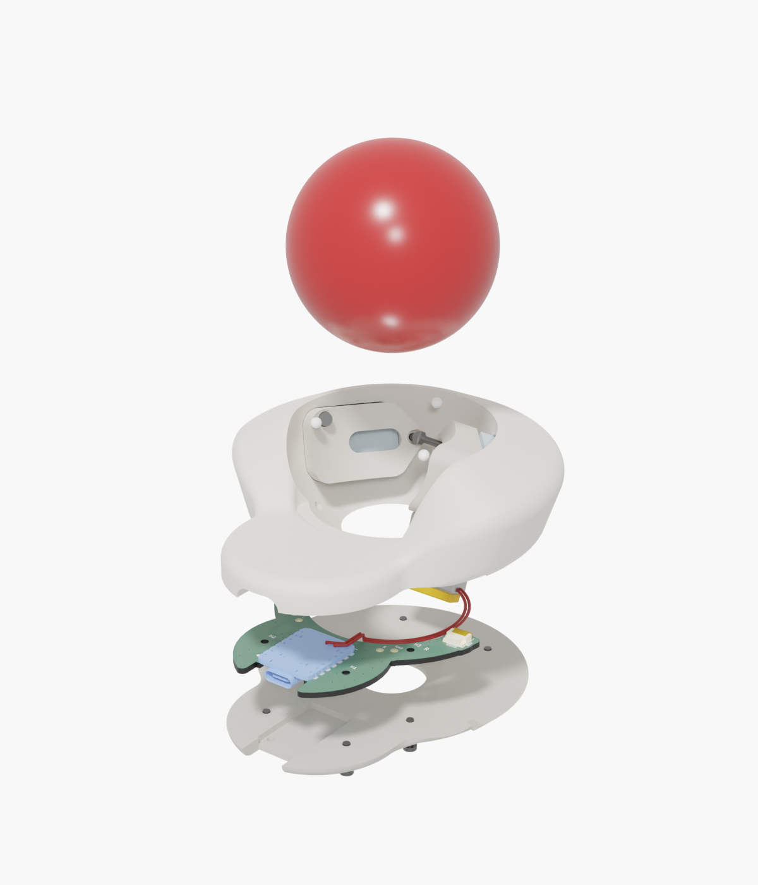
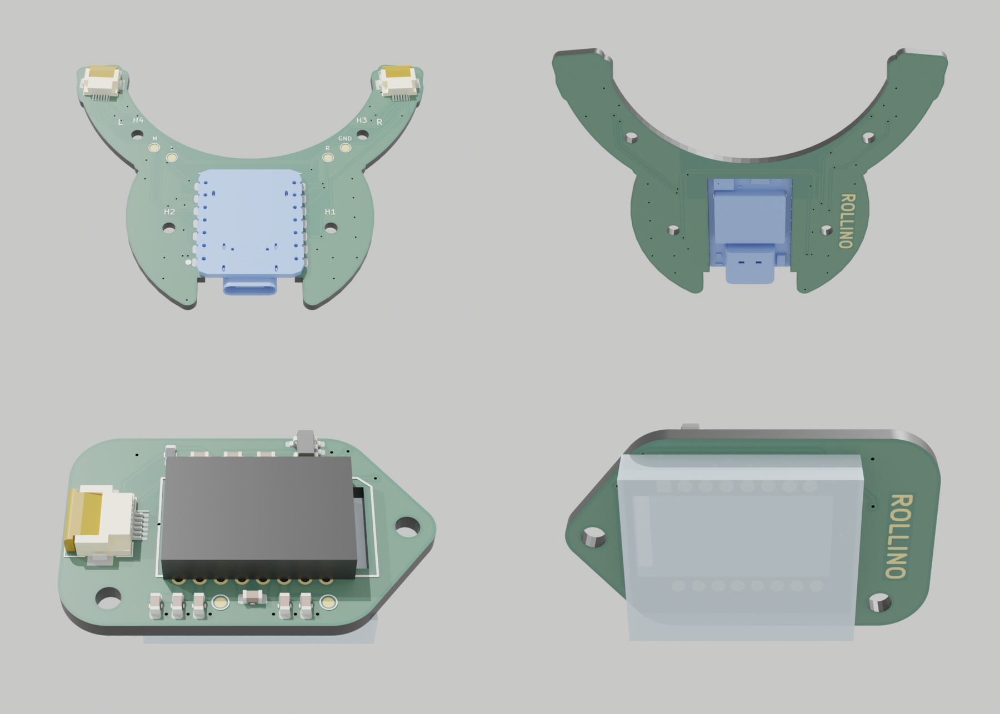

Rollino
=======

An attempt to make a cheap, solid and low profile DIY finger trackball.

The ball floats just 1 mm above the table on three ceramic support balls.
Two PMW3610 sensors look up at the ball from below its equator, placed so
their lines of sight are orthogonal (X, Y and twist are all observable);
their boards lie on their sides in a low ring round the back half of the
ball, each behind a printed cover that follows the ball and has a window for
the lens. A Seeed XIAO nRF52840 running ZMK lies flat in a low pod that swells out of the rim in front of
the ball, soldered upside down onto a base PCB that sits in a groove in the
underside; an FPC ribbon runs from each sensor board to it. The 602020 LiPo
stands in the same ring, between the two sensors and away from the XIAO's
antenna, leaning against the ball at the sensor boards' tilt; its leads run
round in a groove. A cover, a separate printed part, closes the whole
underside (the battery's pocket included), held by six screws.

- `case/rollino.scad` - parametric OpenSCAD model (ball size, sensor/MCU
  placement, battery, ...). Set `part` to `assembly`, `exploded`, `hardware`, `section`,
  or `body` / `base_cover` / `sensor_cover` (print two) for the printable
  parts. `fpc_check`, `wall_check` and `usb_check` should come out empty:
  there is room to pull the ribbons through, no cavity comes too close to
  the outside (`wall_check` does show the open end of the USB plug's recess),
  and the biggest USB-C plug the spec allows (12.35 x 6.5 mm overmold) goes
  in, 0.35 mm clear of the table.
- `case/renders/` - preview renders: `case/render_previews.sh` (OpenSCAD) and
  `case/render_exploded.sh` (Blender, with KiCad's 3D models of the boards:
  the assembled and the exploded view).
- `pcb/` - KiCad projects for the sensor boards and the base board: schematics
  and routed boards, generated from the case model (see [pcb/readme.md](pcb/readme.md)).

- [parts.md](parts.md) - everything to order for one Rollino.
- `datasheets/` - component datasheets. The PMW3610 datasheet is available
  [here](https://www.epsglobal.com/Media-Library/EPSGlobal/Products/files/pixart/PMW3610DM-SUDU.pdf?ext=.pdf).

Firmware
--------

ZMK, built by GitHub Actions on every push (download `firmware.zip` from the
run, then double-tap the XIAO's reset and copy the `.uf2` onto it: its
button faces down, and the cover has a hole under it for a paper clip). It's
a standalone Bluetooth/USB mouse.

- `zmk/boards/shields/rollino/` - the shield: pins, the two PMW3610 sensors
  (Zephyr's driver), three optional buttons.
- `zmk/src/ball_fusion.c` - combines the two sensors: each one only sees the
  ball's surface sliding past in its own tilted plane; together they give the
  ball's whole rotation. Rolling moves the pointer (as if the finger on top
  dragged it), twisting about the vertical axis scrolls.
- `config/rollino.keymap` - the buttons: left, middle, right click.

| XIAO pin | Use |
|----------|-----|
| D4 | SCLK, both sensors |
| D5 | SDIO, both sensors (SPI MOSI and MISO on the same pin) |
| D7 | NCS, right sensor |
| D6 | NCS, left sensor |
| D8 | MOTION, right sensor |
| D2 | MOTION, left sensor |
| D0, D1, D9 | optional buttons to GND: left, middle, right click |
| D3, D10 | free |

**Calibrating the sensors' orientation.** The fusion needs to know which way
each sensor's X axis points (`rotation` in the shield's `ball_fusion` node,
plus the sensor's `invert-x` / `invert-y`), which depends on how the chip
sits on the sensor PCB. The two boards are the same, lying on their sides
and turned half a turn from each other, so the two rotations differ by 180
(90 and 270 to start with). Roll the ball right: the pointer should go right;
towards you: down; twist it: scroll, with no drift. If one direction is off,
try one sensor at a time (cover the other's lens) and fix its rotation /
inversion until rolling right moves the pointer mostly right.
